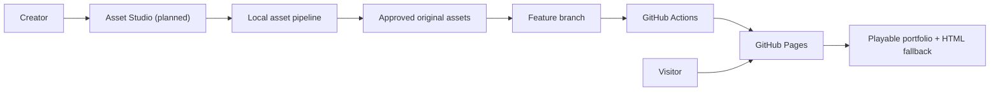
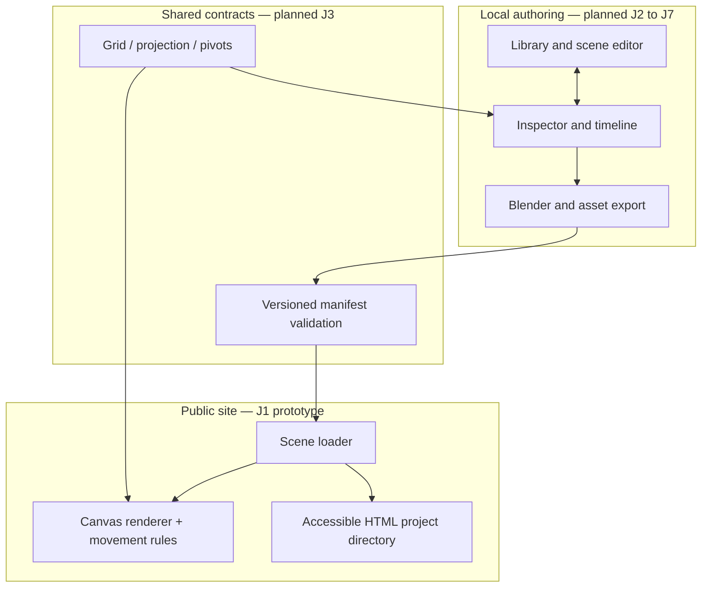
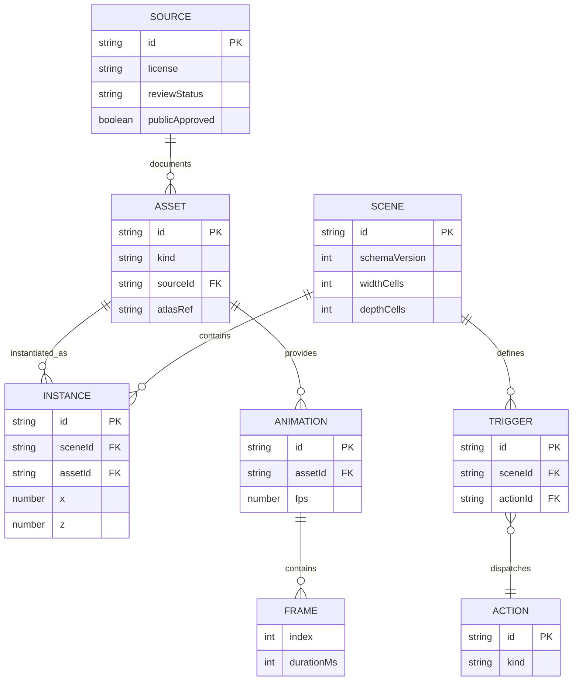
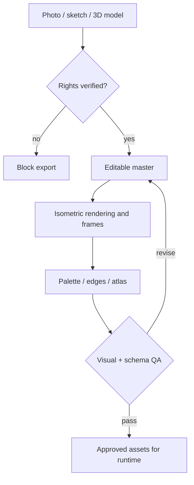
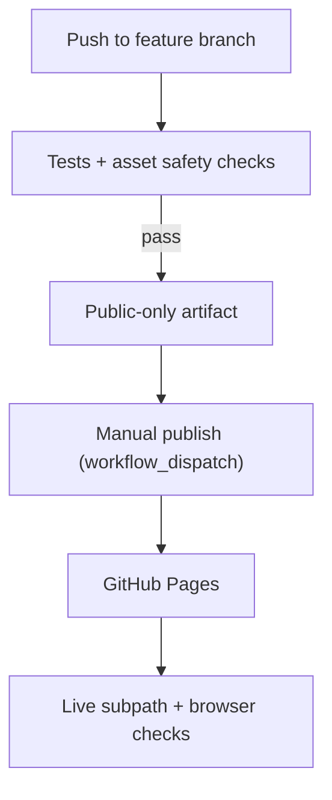

# Architecture — Project Atlas and Asset Studio

## R-series runtime direction (November 2026)

The R-series architecture selects the previously working js-dos 6.22 adaptation as the game runtime. The earlier J-series Canvas prototype and asset Studio remain useful validation tools and development references. The creator and runtime are separate products with a versioned world package between them.

~~~mermaid
flowchart LR
  CREATOR["Independent world editor"] --> PACKAGE["WorldPackage v1"]
  PACKAGE --> ADAPTER["DOS runtime adapter"]
  ADAPTER --> ENGINE["Adapted LBA DOS engine"]
  ENGINE --> JSDOS["js-dos 6.22"]
  JSDOS --> RELEASE["Minimal portfolio site"]
~~~

The [runtime resource audit](R01_DOS_AUDIT.md), [world contract](R02_WORLD_PACKAGE.md) and [DOS compatibility evidence](R03_DOS_COMPAT.md) supersede earlier assumptions about shipping a Canvas-driven public game. Technical experiments using the original game files stay in the owner-local workspace. Public redistribution requires executable and resource rights verification.

Status: **target architecture with partial J1–J8 implementation; diagrams include planned components and are not evidence of finished features.** Branch: feature/portfolio-studio-j1-j8.
This supersedes the public-delivery assumptions in the historical LBA mod plan; those documents and tools remain available as legacy references.

## Architecture map

The diagrams describe system context, module boundaries, data relationships, asset production and public release. Nodes explicitly marked *planned* are not deployed.

### 1. System context — local production versus public experience



**Reading:** the author controls asset production; the visitor only downloads approved static pages, code and images. No ROM, LBA data, hosted editor, account or API server is required to view the portfolio.

[Studio UX and workflows](STUDIO_UX_SPEC.md) · [Asset production pipelines](ASSET_PIPELINE.md) · [Milestones and evidence](MILESTONES.md)

## Product boundaries

| Surface | User | Runtime | Deploy |
| --- | --- | --- | --- |
| Portfolio | Any visitor / recruiter | Static HTML, JS, WebGL/canvas, original game assets | GitHub Pages; no installer, ROM upload, login, API server, or proprietary LBA data |
| Asset Studio | Creator / maintainer | React + TypeScript + Vite; optional local Node/Blender workers for heavy conversion | Local development first; optional read-only web preview later |
| Authoring pipeline | Creator | Deterministic local scripts and Blender renders | Never executes in the visitor's browser |
| Legacy LBA mod | Owner with a lawful game copy | Existing js-dos 6.22 + HQR tooling | **Not** shipped as the public site |

The public URL must render a useful, accessible landing/portfolio experience even if WebGL or game input is unavailable. Gameplay is progressive enhancement, not a barrier to seeing projects or contact details.

## Verified repository baseline (J0)

- `web_deploy/index.html` launches `lba1_portfolio.jsdos` under js-dos; the .jsdos bundle is generated using original .HQR/.EXE files by `scripts/hqr-tools/build-bundle.js`. Current output is **not eligible for public Pages deployment**.
- `metadata-ui/src/App.jsx` is a large single JSX module with Scenes/Sprites/Bricks views and dense legacy metadata.
- `metadata-ui/src/AssetUploader.jsx` imports PNG, palette-snaps against an extracted LBA palette, previews and PUTs replacement data.
- `metadata-ui/vite.config.js` implements dev-only POST/PUT-style file-writing middleware and spawns Node scene injection; it cannot run on GitHub Pages.
- `render-scene.js`, `inject-scene-image.js`, `lib/sprite-codec.js`, `create-savegame.js`, and `patch-relent.js` are valuable reverse-engineering/codec references. No automatic license assumption applies to their inputs, generated PNGs, palettes or JSON metadata.
- The original game assets are gitignored in `.gitignore`; the public build must additionally fail closed if any proprietary content is accidentally staged.

## Module boundaries — planned end state



**Reading:** Studio, pipeline and shared contracts are target components. Only the J1 original Canvas2D proof in `apps/portfolio/` currently exists; no universal asset schema is implemented. The Studio is **local**, so its write APIs never run on GitHub Pages.

## Target ownership layout (migrate incrementally)

```text
apps/
  portfolio/        # static public game and accessible project fallback
  studio/           # creator's editing tool; never bundled into public app
packages/
  asset-schema/     # validated versioned manifests and types
  rendering/        # shared projection, depth, anchors, asset preview
  game-core/        # deterministic scene, interactions, game state
pipeline/
  import/           # source ingestion, provenance/license checks
  blender/          # offline reproducible iso rendering
  processing/       # pixel cleanup, palette, crop, atlases
assets/
  sources/          # originals/photographs/models, rights recorded
  masters/          # editable art and scene definitions
  game/             # only cleared original/licensed game-ready exports
legacy/             # historical tooling after explicit move/audit
docs/
tests/
.github/workflows/
```

Do NOT move or delete `metadata-ui`, `web_deploy`, `scripts/hqr-tools`, or old docs as a prerequisite. The initial J1 proof-of-concept may coexist in `apps/portfolio`; migration comes after import/export contracts exist.

## Logical data model — provisional, not a database



**Model semantics:** `ASSET` is a reusable sprite/prop/model output; `INSTANCE` is its placement in a particular `SCENE`; `TRIGGER` dispatches an `ACTION`; `ANIMATION` contains ordered frames. `SOURCE` holds provenance/license records. Coordinates, draw pivot and collision footprint are deliberately distinct. J3 must finalize JSON Schema, TypeScript types, cardinalities and cross-reference checks before authoring depends on these diagrams.

## Runtime design

- Candidate engine: Phaser 3.x/4.x, to be selected by a compatibility spike, including isometric Tiled map behavior, batching, animation and mobile input. Prefer an explicit adapter so an engine change does not alter asset manifests.
- Choose a documented world coordinate convention and implement it once in `packages/rendering`: logical grid X/Z horizontal and Y height; screen projection, depth ordering, pivots and collisions are independent concepts. Verify against screenshots and editor overlays.
- Scene manifest defines tile layers, static furniture, animated props, NPC spawn, triggers, camera framing, navigation blockers, exits, dialogue and links to projects.
- Rendering assets are PNG/WebP/atlas metadata made from original or appropriately licensed sources, not extracted LBA sprites, tiles, models, audio, palette, or scene data.
- Runtime reads versioned JSON manifest; no server writes, remote data dependencies, user account, ROM import, or executable game archive.
- Studio uses the same scene and projection library as runtime for a trustworthy preview; heavy generators stay local.
- Basename-aware URLs: test at `/lba-custom-portfolio/`, not just root `/`; Vite `base` configured accordingly for Pages.

## Asset production and approval gate



**Reading:** segmentation, 3D reconstruction and automatic stylization are authoring aids, not guaranteed accurate or legally cleared results. Human review and original/licensed sources remain mandatory. The final scene contains editable independent placements, not a single flattened image.

## Ownership, intellectual property and security

- No original LBA `.HQR`, `.EXE`, `.jsdos`, CD `.ISO`, extracted derived artwork, or game-specific copied dialogue in public build.
- GPL availability of a game engine does **not** license proprietary assets; recreate a distinct world, designs and names. No promise that a style reference alone avoids infringement; review finished art.
- Manifest must record `origin`, `creator`, `source_url` (when applicable), `license`, `attribution`, `review_status` and `allowed_for_public_build`.
- Default deny for any item missing an explicit approved provenance/license record. Keep an allowlist of safe licenses/individual permissions and require attribution where necessary. Generated material is not automatically copyright-clear.
- Reject traversal paths, unsupported formats, huge files, malicious SVG/scripts, decompression bombs and badly structured atlases in all import steps.
- Secrets/credentials are not embedded in the static site. Contributor edits happen in local tooling and Git, not a public write API.

## Release architecture — GitHub Pages



**Current CI state:** the J1 branch workflow has passed once. Its Pages publication job is **manual**, and the real deployed URL has **not** been browser-verified. A passing Actions job alone does not close J1. The public artifact must exclude `web_deploy/` and any original game files.

## Release and measurable quality

- Public site: clean first load from a direct URL; keyboard/touch controls and a noninteractive fallback with project links; no mandatory pre-download beyond normal static site assets.
- First-play: prioritize critical atlas/scene only; lazy-load other rooms; compressed original artwork; bounded texture memory; FPS and accessibility tested on real desktop and mobile.
- Continuous checks: typecheck/lint/unit schema tests, browser E2E from a nested path, visual screenshot regression, bundle size audit, content-provenance scan.
- Deployment uses GitHub Actions with a build artifact containing **only** `apps/portfolio/dist`. Public publishing is gated on those checks and Pages repository settings. Do not assume Pages is already enabled.
- Preserve `main` untouched; use feature/portfolio-studio-j1-j8 with atomic commits and a push per *completed and tested* milestone; no merges without a later explicit request.

## Architecture decisions to validate at J1

1. Phaser stable release/version or lean Canvas2D prototype; choose based on bundle footprint, isometric maps, rendering quality and tests.
2. Final JSON schema and coordinates plus importer behavior; establish fixtures and round trips before migrating studio.
3. Asset storage strategy for large editable masters (Git LFS or separate storage if needed; avoid exceeding Pages/repo limits).
4. Static hosting of the public game vs a separately deployed static studio preview; authoring remains local.

## Documentation maintenance

Diagrams are versioned directly in this Markdown file using `mermaid` fences supported by GitHub. For every change to an interface, asset schema or release boundary, update the relevant diagram **and** its textual contract; do not mark an unimplemented node as complete. Prefer several small readable diagrams over one oversized wall of arrows.

## Revised production priorities

The [current asset-first roadmap](MILESTONES.md) supersedes the earlier workflow ordering: J2 is the local recipe-driven asset pipeline; J3 is its actual rendered QA batch; J4 is a fully polished original playable room; J5 is the simplified creative GUI. Previous Studio and schema prototypes are preserved but are not prerequisites for conversion. See [asset pipeline instructions](../pipeline/README.md).
