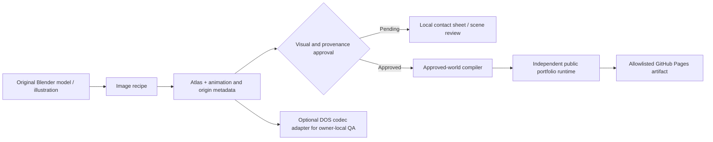

# Original asset delivery — merge and publication boundaries

Date: 2026-11-14. Active development branch:
`fix/r05-1-runtime-probes`. This is an asset-first course correction
after validating the js-dos 8.5.4 private DOS emulator with the
original commercial LBA1 installation.

## Decision

Prioritize **original characters, rooms, props, animation and sound**.
Stop treating reproduction of the commercial game's soundtrack,
introductory cinematics or every death transition as a dependency of
new artwork. Freeze the R05 DOS configuration and keep its observed
regressions documented for the private technical demo.

The repository already implements the necessary authoring boundaries:



Existing implementations:
- `pipeline/blender/`: original isometric source rendering.
- `pipeline/asset_batch.py`: image/alpha/atlas preparation and contact sheets.
- `pipeline/compile-approved.mjs`: gated authoring-to-runtime conversion.
- `packages/asset-schema/`, `packages/world-package/`, `packages/scene-core/`:
  versioned world and independent scene contracts.
- `adapters/lba-dos/`: optional private DOS format test adapter.
- `apps/portfolio/`: independently authored public browser runtime.
- `scripts/build-portfolio.mjs`: allowlisted original-art public artifact.

These boundaries must be reused. A parallel image converter, unapproved
auto-export or second scene model would add complexity without evidence
of improved output.

## Concrete new golden-sample recipe

`apps/portfolio/sprite-demo/compare/field-receiver.recipe.json` now
uses the four **existing Blender source renders**, rather than
recreating assets or uploading game files:

- `source-ne.png`, `source-nw.png`, `source-sw.png`, `source-se.png`
- Stable source-space crop **[103, 35, 665, 597]**, reused from the
  documented V6 export matrix
- 256 × 256 RGBA frames, four views, common source crop and pivot
- `style.colors = "truecolor"`: no forced 256-color palette or
  binary-alpha threshold; legacy indexed mode remains available
- Provenance status **pending**, `allowedForPublicBuild = false`

The fixed source-space crop prevents per-direction normalization of
the silhouette from shifting the camera anchor. These geometry and
alpha properties can be measured. Recognition, texture quality and
publication rights still require a human review.

```bash
cd ~/Documents/lba-custom-portfolio
python3 -m pip install Pillow==11.3.0
python3 pipeline/asset_batch.py \
  apps/portfolio/sprite-demo/compare/field-receiver.recipe.json \
  --out output/field-receiver-review

# Review the ACTUAL exported PNGs and contact sheets:
# output/field-receiver-review/index.html
# output/field-receiver-review/atlases/field-receiver.png

python3 -m unittest discover -s pipeline/tests -v
node --test pipeline/compile-approved.test.mjs
```

The original Blender reference art is already versioned in this public
repository. **The recipe does not change its rights status or
automatically approve it for release.** Its output remains in
`output/`, which is excluded from Git.

## Distinguish code merge from publishing a game

**Code merge:** the original image converters, authoring schema,
tests and original-art rendering components can be merged after
reviewing source licenses, tracked-file content and regression
coverage. This does not require the whole original world to be finished.
The R05 branch was 248 commits ahead of `main` at the beginning of this
audit; cherry-pick or stage coherent reviewed changes rather than
considering all 248 commits a single release-ready unit.

**Public distribution:** the installed GOG `RELENT.EXE`, modified
copies of that commercial executable, HQR/VOX/ISO/FLA, original
scenes/dialogue, branded characters and recordings are excluded from
the Pages artifact. Even a visually complete replacement does not
automatically grant permission to distribute the retail executable
or any remaining commercial resources.

The separately published LBA1 **engine source** is GPL-licensed.
Its author explicitly says the original game assets are excluded.
A DOS-first public game could in principle use a compiled GPL-covered
engine, complying with GPL obligations (appropriate license, source
availability, notices and compatible included components), with every
required data file replaced by original or separately licensed content.
The current *commercial executable* pipeline does **not** establish
that this route is ready. The public independent Canvas2D portfolio
already avoids that licensing/compatibility dependency.

Sources:
- https://github.com/LBALab/lba1-classic-community
- https://www.legifrance.gouv.fr/codes/article_lc/LEGIARTI000006278919/2026-08-06

Protect the final original work from confusing association with the
commercial game's recognizable names, characters, world design,
original 3D forms, title treatments, and recordings. A generic
isometric adventure visual language may be used, but no technical
test can guarantee absence of infringement.

## Public artifact separation — changed on this branch

`scripts/build-portfolio.mjs` now assembles only the independently
authored static portfolio, its explicit original-art demos, and approved
atlas assets. It no longer copies `web_deploy/` into `dist/`.

The js-dos 8.5.4 player and the R05 experimental archives are
**preserved under `web_deploy/` and gitignored `output/`** for
owner-local research. The older public Pages DOS import route is no
longer part of a fresh Actions-based `dist/` release. This removes
the previously inconsistent packaging of a v8 HTML launcher alongside
a v6.22 JavaScript emulator.

`tests/public-build.test.mjs` and
`apps/portfolio/test-e2e.mjs` now explicitly reject a publicly
served `/web_deploy/` route. Production approval remains separate:
`node scripts/release-audit.mjs --strict` should continue to reject
the current empty approved-art catalog.

**Important:** this separation protects the explicit `dist/` artifact,
not every file visible in a publicly accessible Git branch or its
history. If GitHub Pages is still configured to publish the branch
root, repository source files and old routes may remain publicly
accessible. Confirm Settings → Pages → Source → GitHub Actions
before describing `dist/` as the only exposed site.

The repository still tracks historical `metadata-ui/src/data/*HQR.json`
files. Their contents and origin must be audited before asserting that
the whole public repository has no game-derived data. Avoid adding
any further extracted source material; do not rewrite history casually
without explicit review.

## Next acceptance gates

1. **Golden sample**: inspect the four truecolor render views and
   shadows/alpha at 1:1, in-game 1×/2×, and on light/dark backdrops.
   Confirm camera origin does not drift. Request a revision if not.
2. **One original room**: produce an authored electronics bench scene
   with separately placeable props, a character and a four-frame
   animation. Reuse the actual atlas compiler and independent scene
   runtime; no flattened-background-only victory.
3. **Provenance review**: verify original Blender sources, textures,
   artwork references and third-party tool licenses; approve explicit
   assets by ID only after real inspection. Never auto-promote
   synthetic fixtures or old LBA assets.
4. **Merge candidate**: run Python/Node tests, output digest QA,
   source license and tracked-file checks, and build the exact public
   `dist/` artifact. Keep old R05 code only behind local-private
   workflows, with no proprietary game bytes committed.
5. **Public release**: require a non-empty reviewed art manifest, a
   playable original world, the strict release audit, real desktop/
   mobile QA and manual Pages approval. Release remains blocked until
   these conditions pass.

The merge and release checkpoints are deliberately different:
a passing technical asset pipeline is useful progress, while a
working prototype alone does not establish art quality or legal
clearance.
