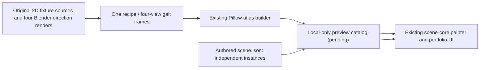

# First playable original workshop — local end-to-end asset pipeline proof

**Status:** working branch experiment, artwork and layout **pending review**.
**Purpose:** test whether the current open-source portfolio creator's real
data flow can produce a usable world without any LBA game installation.
Do not call this a finished editor or polished release.

## Playable scene

The workshop has a 10 × 10 independently authored isometric grid and
eight independently placeable objects:

| Instance | Original asset | Position | Interaction |
| --- | --- | --- | --- |
| `cinepi` | authored camera rig | (2,2) | Opens CinePi project/source |
| `lora` | four-view original Blender telemetry receiver | (7,2) | Opens long-range LoRa details |
| `bigbrain` | electronics workbench | (2,7) | Opens BigBrain information |
| `shellfolio` | original terminal-like RF console | (7,7) | Opens ShellFolio project/source |
| `chair-main` | chair | (5,4) | Solid furniture; blocks movement |
| `door-main` | workshop door | (0,0) | Solid decorative structure |
| `lamp-east`, `lamp-west` | original indicator lamps | (8,4), (1,4) | Animated four-frame active state |

A separate, original `workshop-guide` character has four idle views
and **four authored gait frames per NE, NW, SE and SW direction**.
The existing scene-core uses action, direction and frame duration to
select real regions of the generated RGBA atlas. Walking uses a
short 560-ms animation window, then returns to idle. This is a
rudimentary animation *pipeline*, not an animation editor.

The existing portfolio controls remain unchanged: WASD/arrows to
move, **E** to inspect a nearby station, project links in the details
panel, touch controls, and a non-game directory for accessibility.
The art is composited as distinct sprites on the existing Canvas
isometric floor. The decorative chair blocks player movement;
objects are not flattened into a single scene image.

## Build and run on Debian

From the repository root on `fix/r05-1-runtime-probes`:

```bash
python3 -m pip install Pillow==11.3.0

# One command regenerates original source views, atlases, a scene and
# the independent local HTML/JS/browser preview:
node pipeline/build-workshop-preview.mjs

# Launch the independent original portfolio; NOT the js-dos LBA player.
python3 -m http.server 8766 --directory output/workshop-preview
```

Open **http://127.0.0.1:8766/**. The page displays a conspicuous
LOCAL ASSET REVIEW banner, uses the same public portfolio UI and
original scene-core renderer, and reads only preview-specific data
from `assets/preview-worlds.json`.

Inspect the **actual generated** contact sheet under
`output/workshop-atlases/index.html`. The corresponding generated
images, source PNGs and editable recipe live under gitignored
`output/workshop-atlases/` and `output/workshop-sources/`.

On CI, the artifact `original-workshop-local-preview` contains the
built static preview, atlas contact sheets and Chromium screenshot.
This is a QA artifact; the build does not invoke Pages deployment.

## How the existing tools create this scene



- `pipeline/fixtures/generate_samples.py`: existing owner-created art
  functions; the new `generate_workshop.py` orchestrates these and
  samples three distinct physical gait poses per direction.
- `apps/portfolio/sprite-demo/compare/source-*.png`: existing
  real Blender-rendered telemetry receiver, cropped consistently
  before conversion; no commercial game geometry.
- `pipeline/asset_batch.py`: real atlas conversion, truecolor RGBA,
  common fixed crop and source/provenance hashes.
- `examples/workshop/scene.json`: versioned scene source. Its
  instance positions match the existing `ROOMS[0].projects` hotspots.
- `packages/scene-core/scene.mjs`: projection, depth sort, animation
  frame selection, drawing and solid-furniture occupancy.
- `apps/portfolio/approved-runtime.mjs`: the same renderer used by
  public approved art; `createWorldRenderer` separates painting from
  the strict public provenance check.
- `pipeline/preview-runtime.mjs`: a **local-only** data adapter
  that refuses approved flags and can never be copied into `dist/`
  by the public allowlisted builder.
- `pipeline/build-workshop-preview.mjs`: produces the isolated
  preview by reusing `scripts/build-portfolio.mjs` and substituting
  only the one local asset data adapter **inside ignored output/**.
  Source `apps/portfolio/assets/approved-worlds.json` is unmodified.

## Automated acceptance

```bash
python3 -m unittest discover -s pipeline/tests -v
node --test pipeline/compile-approved.test.mjs
node pipeline/build-workshop-preview.mjs
node pipeline/test-workshop-preview.mjs # Playwright Chromium installed
node --test tests/public-build.test.mjs tests/pages-root.test.mjs
```

The browser test uses the **real generated PNG files**, confirms all
eight placed objects load, verifies the player renders multiple walk
atlas rectangles, walks near ShellFolio and presses E, checks the
real project hyperlink, selects CinePi from the directory, and
checks the preview art does not leak into an unrelated room.

It also asserts that the public
`assets/approved-worlds.json` remains empty and that all preview
sources are explicitly `reviewStatus: pending` and
`allowedForPublicBuild: false`. The strict public release audit
must continue to fail until a human approves real production art.

## Known shortcomings — the next actual product work

This experiment does **not** supply a general artist-facing GUI:

1. The character's gait is authored procedurally in Python. There is
   no rigging, skeletal or keyframe editor, skin/appearance customization,
   sprite-sheet pose editor, or animation timeline UI.
2. Scene positions are currently edited via a JSON file. There is no
   scene object palette, gizmos, drag/drop placement, collision preview,
   undo/redo, custom project-link form, or visual scene export wizard.
3. Several assets are synthetic QA drawings with limited art direction;
   a correctly exported atlas does not make these production artwork.
4. The author-specific project directory is currently `rooms.mjs`.
   A reusable portfolio creator needs project metadata, scenes and
   URLs in an editable, validated user-owned world document.
5. The original V7 layered Blender workshop background is a visual QA
   study, **not** the layout used by the playable grid. Integrating
   occlusion, shadows, common camera settings and art direction into
   the actual scene editor remains a significant task.
6. Soundtrack, sound effects, startup animations and an accessibility
   pass for the creator UI have not been implemented for the original
   independent engine.

**Next decision gate:** have the owner review the first scene screenshot
and test the local interaction. If art quality is unacceptable, improve
the source model/render/animation authoring controls before adding
general editor functionality. If the behavior and data contract are
acceptable, implement a minimal interactive room authoring flow that
edits the existing JSON schema rather than inventing a new one.
No merge to main without owner approval.
