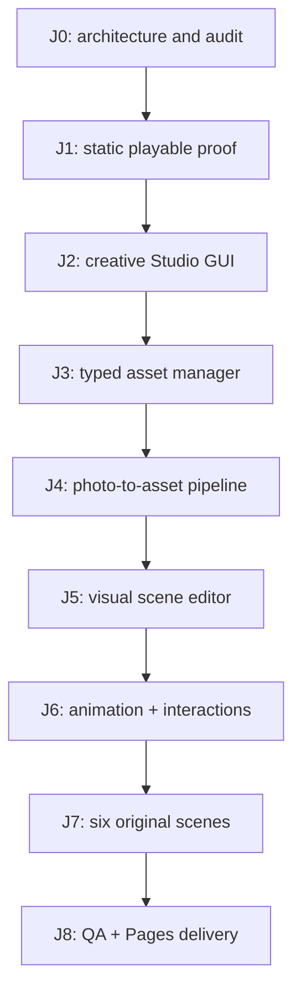

# Milestones, branch policy, and acceptance criteria

Status: J0 documented only. Follow exact branch **feature/portfolio-studio-j1-j8** (derived from main 0428b533); do not merge to main.

## Rules

- Document constraints and design decisions **before** implementation. Do not replace the existing LBA files prematurely.
- Use small cohesive commits (schema/tests, runtime, UI, pipeline, fixtures, docs as appropriate). Each commit must represent working, reviewable progress where feasible.
- After *each milestone's tests pass*, push that milestone to the dedicated branch and record commit SHA, tests, and open issues in the ledger below. GitHub connector commits update this remote branch immediately.
- A milestone is not 'done' because code was created; enforce its acceptance gate and distinguish **not run**, **pass** and **fail**.
- No merges, no deployment of copyrighted LBA content, no force push, no deletion of user work.
- Public runtime never depends on local authoring services. Public Pages deployment requires GitHub Pages settings and a functioning build workflow; a checked-in workflow alone does not prove publication.

## Milestone dependencies

**This is the intended order, not a completion diagram.** The state and CI evidence live in the acceptance table and delivery ledger below.

## Gate definitions

| Gate | Goal | Acceptance proof | State |
| --- | --- | --- | --- |
| J0 | Audit and agree architecture, UX, asset pipeline, legal/deploy boundaries | Files documented; existing paths audited; branch created | Documentation complete; no implementation |
| J1 | Static playable isometric original prototype | Real Pages-compatible build at repo subpath, movement, collision, interaction, accessible project fallback, no LBA binary, automated tests | **In progress: CI passed; public Pages/browser acceptance not yet verified** |
| J2 | Modern creative UI | Actual desktop/narrow interface, real library/viewport/inspector/timeline, usable edit/preview flow, a11y states | Pending |
| J3 | Unified asset contract and manager | Runtime schema + valid manifest, tests against malformed inputs, source provenance, import/edit/export round trip | Pending |
| J4 | Photo/model to sprites/props | Test fixtures: one character + three different furniture/props, reproducible pipeline, multi-view validation and visual review | Pending |
| J5 | Visual scene editor | Compose, position, layer, collide, save/export and play an original room without manually editing JSON | Pending |
| J6 | Animations and interactions | Editable/scrubbable timeline, NPC walk/talk, door + monitor + machine, proper events, tested runtime | Pending |
| J7 | Six portfolio scenes | All six original rooms, projects/contact content, internal navigation, verified content/license completeness | Pending |
| J8 | Ship-ready hardening | Unit/integration/E2E/visual tests, responsive + keyboard/touch, load/perf budget, license audit, successful GitHub Pages publication | Pending |

## Constraints and non-goals

- J1 must be minimal and testable; do not prematurely build the entire editor or require Blender for visitors.
- J2/J3 should establish the shared schema before extensive J4/J5/J6 production.
- J7 recreation uses a distinct visual identity, not original character/scene/voice assets or protected marks.
- No giant unstructured logs, JSON text blocks or fake diagrams as everyday Studio UI; consult STUDIO_UX_SPEC.md.
- Current old mod/js-dos launcher is retained for lawful local experimentation but excluded from public dist.
- AI-based photo conversion is optional and subject to quality, licensing, GPU requirements, and explicit user review.

## Audit findings from main (initial)

1. Existing React `metadata-ui` depends on Vite middleware (`/api/save-asset/`, `/api/save-scene/`), a local Node process, and LBA palette/metadata; not directly publishable as a GitHub Pages editor.
2. `web_deploy` creates a js-dos archive from original `.HQR`, `.EXE` and an ISO; copying it to the public site would redistribute protected game files.
3. Existing scripts include per-scene render/inverse mapping and palette/codec logic. Reuse algorithms only after reviewing license/original-data coupling; new portfolio scene objects need per-instance placement.
4. Existing README and `docs/PORTFOLIO_MOD_PLAN.md` describe the original mod workflow and may contain historical/obsolete location details; treat them as archival, not authority for the new game.
5. No public standalone portfolio runtime, UI test suite, project-root monorepo scripts, asset rights ledger or Pages workflow exists on the audited main tree.
6. Visual and accessibility verification requires real screenshots and browser interaction; no claim of tested UX until the test has actually run.

## Milestone delivery ledger

| Date | Gate | Commit(s) | Verification | Notes |
| --- | --- | --- | --- | --- |
| 2026-11-01 | J0 | 7e9bb42 | Repository audit + four checked-in specs | Completed documentation baseline |
| 2026-11-01 | J1 (WIP) | 114e37a, cb2cb06 | Browser-static game source, original procedural scene, Node test suite, optional Pages workflow; V8 smoke of seven pure rule checks PASS; file syntax PASS | CI run 41253304495 passed (commit cb2cb06); no verified live Pages deployment or browser E2E. Do not mark accepted. |

## Documentation acceptance criteria

The [architecture page](ARCHITECTURE_TARGET.md) must include rendered system, module, data, pipeline and delivery diagrams; [Studio UX](STUDIO_UX_SPEC.md) must describe workflows as actual visual tasks; [asset production](ASSET_PIPELINE.md) must distinguish characters, furniture, scene construction and animation. Links to these documents must be visible at the **top of the repository README**.

## Docs map

- `docs/ARCHITECTURE_TARGET.md`: target topology, contracts and public deployment restrictions.
- `docs/STUDIO_UX_SPEC.md`: layout, ergonomics, visualization and data presentation requirements (planned J2).
- `docs/ASSET_PIPELINE.md`: source photo/3D to scenes, characters, props and animations; repo reuse candidates (planned J3–J6).
- This file: gates and evidence requirements.
