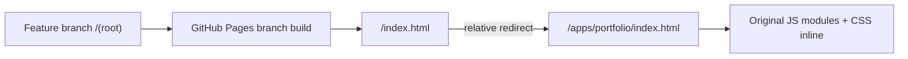

# Deployment decision — GitHub Pages

**Actual configuration supplied by the maintainer:** Source = GitHub branch `feature/portfolio-studio-j1-j8`, folder `/(root)`. A previous assumption that the Actions-only artifact was live was incorrect.

## DOS reconstruction visual QA staging

The [revised R04–R09 plan](DOS_REBUILD_PLAN.md) adds a temporary original-asset QA route to GitHub Pages and a README entry point. This staging surface may show only redistributable original art, measurement reports and approved browser previews.

A privately reconstructed DOS bundle assembled from an owned commercial game installation is used for local verification. Publishing that bundle requires independent redistribution clearance for all embedded components. The final Pages artifact will contain only the finished portfolio. All preview links must be verified against the deployed site before they are described as working.

## Current publication route (no settings change)

- A minimal root `index.html` redirects using a relative URL; a visible HTML link works without JavaScript.
- `.nojekyll` opts out of Jekyll transformations and keeps ES modules and asset paths unchanged.
- This preserves the user’s configured branch-root deployment; no Pages settings change is necessary.
- The runtime must use only relative module and asset URLs; local and browser tests must include the repository subpath.
- The historical js-dos source remains in the repository but no proprietary game .EXE/.HQR/.ISO/.jsdos files are tracked. **With branch-root publication the rest of the repository may also be publicly retrievable; do not commit private inputs or secrets.**

## Cleaner future release (requires a conscious settings change)

Publishing a GitHub Actions artifact containing only `dist/` would reduce the exposed source surface and avoid branch-root workarounds, but this changes Pages Source settings and is **not being done silently**. The GitHub Actions publish job now runs `scripts/build-portfolio.mjs` and uploads exactly the same allowlisted `dist/` checked by CI. No manual hard-coded copying of a subset of runtime modules remains.

## Verification gate

The last recorded `pages build and deployment` run was successful, but **a successful Pages build is not proof the user-facing URL loads**. Verify the root and nested URL in a real browser after this commit, including network requests, mobile controls and all six scenes. J1/J8 remain open until live verification evidence is recorded.

## J1 artifact parity and switch-over

The project-subpath browser test now reads from **the built `dist/` artifact**, rather than the source directory. Both verification and deployment invoke the same builder. The workflow currently deploys only via an explicit `workflow_dispatch` event; there is no implicit release from code pushes.

When switching **Settings → Pages → Source → GitHub Actions**, manually run the workflow **Portfolio CI and optional Pages deployment** on the feature branch. The publishing job must pass before visiting the root URL. Never select a `/dist` folder in branch-source settings (GitHub Pages supports branch root or `/docs`, not arbitrary directories).
