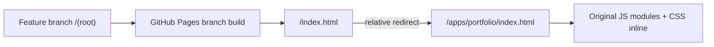

# Deployment decision — GitHub Pages

**Actual configuration supplied by the maintainer:** Source = GitHub branch `feature/portfolio-studio-j1-j8`, folder `/(root)`. A previous assumption that the Actions-only artifact was live was incorrect.

## Current publication route (no settings change)

- A minimal root `index.html` redirects using a relative URL; a visible HTML link works without JavaScript.
- `.nojekyll` opts out of Jekyll transformations and keeps ES modules and asset paths unchanged.
- This preserves the user’s configured branch-root deployment; no Pages settings change is necessary.
- The runtime must use only relative module and asset URLs; local and browser tests must include the repository subpath.
- The historical js-dos source remains in the repository but no proprietary game .EXE/.HQR/.ISO/.jsdos files are tracked. **With branch-root publication the rest of the repository may also be publicly retrievable; do not commit private inputs or secrets.**

## Cleaner future release (requires a conscious settings change)

Publishing a GitHub Actions artifact containing only `dist/` would reduce the exposed source surface and avoid branch-root workarounds, but this changes Pages Source settings and is **not being done silently**. The existing workflow publish job must also be updated to include `rooms.mjs` and any future sprite files before it is usable.

## Verification gate

The last recorded `pages build and deployment` run was successful, but **a successful Pages build is not proof the user-facing URL loads**. Verify the root and nested URL in a real browser after this commit, including network requests, mobile controls and all six scenes. J1/J8 remain open until live verification evidence is recorded.
