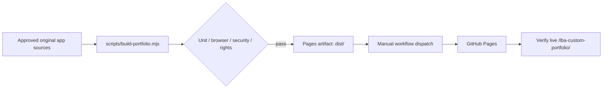

# Public release readiness and remaining acceptance gates

Status: **J8 hardening in progress; not deployed or production-accepted**.

## Build and delivery contract



Only the original public runtime files enter the artifact. The Studio, Blender pipeline, docs, js-dos bundle and HQR assets are **not** deployed.

### Completed engineering controls (source-level)

- Public build uses an exact allowlist; banned original game formats cannot leak from a repository-wide copy.
- Rule tests cover movement boundaries, collisions, interactions and room data.
- Headless Chromium CI includes a project-subpath smoke, desktop/mobile screen capture and HTML project directory.
- Studio is compiled separately; the public site never requires its Vite development endpoints.
- Asset schema enforces review states, declared license, attribution, safe relative paths and references.
- Python photo-to-sprite pipeline has deterministic synthetic-image tests. Blender export remains unverified on a real 3D model.

### Required before declaring J1/J2/J3/J4/J5/J6/J7/J8 complete

| Gate | Remaining evidence |
| --- | --- |
| J1 | Actual Pages URL opens from a clean session; real keyboard/touch use, live hosting config |
| J2 | Visually review screenshots, keyboard accessibility, difficult data and undo/redo recovery |
| J3 | End-to-end versioned scene/asset bundle loaded by *both* public runtime and Studio; published provenance ledger |
| J4 | Real licensed photographs + one character and three props, Blender render benchmark, cross-angle review |
| J5 | Studio authored scene exported into runnable portfolio without manual source edits, pixel-position parity |
| J6 | Real animation asset frames and a running trigger/event state machine, sprite frame sourcing |
| J7 | Art and copy review for all six rooms; accurate links and independent accessible navigation |
| J8 | Visual regression/performance checks, actual deployment and a verified public site URL |

A passing CI pipeline is not a substitute for manual rights review, visual inspection and live GitHub Pages verification.

## Permissions and branch policy

**Feature branch:** `feature/portfolio-studio-j1-j8`. Do not merge to `main`. Only commit + push incremental work on this branch. The Pages job is intentionally manual (`workflow_dispatch`) until public readiness is accepted. GitHub Pages must be configured for GitHub Actions in repository settings. This process cannot infer or guarantee repository Pages settings from a passing unit test.

## Local commands

```bash
node --test apps/portfolio/rules.test.mjs apps/portfolio/rooms.test.mjs
node scripts/build-portfolio.mjs
node --test tests/public-build.test.mjs
cd apps/studio && npm install && npm run build
python3 -m unittest discover -s pipeline/tests -v
```
