# R06.1 — First original asset rendered by the actual DOS engine

**Status:** deterministic private overlay generation and synthetic CI checks
implemented. **Original game visibility, frame quality and script compatibility
still require owner-local manual acceptance.** No modified original game content
is committed or hosted.

## Objective

Replace one existing sprite reference **in the genuine DOS scene** using
original Blender-based telemetry receiver artwork. This is **not** a new
JavaScript game renderer.

Source artwork: the already versioned original four-view
`apps/portfolio/sprite-demo/compare/192px-lanczos-160.png`.

Target evidence: `metadata-ui/public/scene-sprites.json` reports
**Museum, scene 43** references sprite **58**, described in
`metadata-ui/src/data/SPRITES.HQR.json` as "Door padlock (Forger's house)".

This entry is also referenced by **scene 1**, so it is a **global
sprite substitution**, not a newly placed independent prop. This is
strictly a technical end-to-end experiment to prove that our source
art can reach the *actual* DOS rendering path. A small padlock sprite
will not necessarily give satisfactory receiver readability or scale.
Do not call it a finished replacement or new original room.

## Tested native delivery path

```mermaid
flowchart LR
  Original["Original Blender V5 receiver atlas"] --> View["One original direction, source view SE"]
  View --> Resize["Native size/pivot from original private DOS sprite 58"]
  Resize --> Index["Existing game's original 256-color palette"]
  Index --> Codec["Existing DOS indexed row-RLE codec"]
  Codec --> Verify["Payload decode and all-other-entry HQR preservation"]
  Verify --> Overlay["Ignored output/R06/SPRITES.HQR"]
  Overlay --> Zip["Same working private v8 ZIP, one changed file"]
  Zip --> DOS["Original RELENT.EXE executed with js-dos 8.5.4"]
```



Actual logic reuses:
- `adapters/lba-dos/index.mjs` crop and antialias-aware resize,
- `packages/asset-core/index.mjs` palette quantization, sprite codec
  and exact round-trip,
- `adapters/lba-dos/overlay.mjs` HQR decoder and native palette;
  a new **single-entry** replacement function preserves native
  dimensions and drawing offsets,
- `scripts/runtime/overlay-r05-v8-sprite.py`, which verifies source
  HQR SHA-256 and preserves **all non-SPRITES.HQR ZIP contents byte-for-byte**,
- the historical R05 `RELENT.EXE` four-signature cinematic guard.
  
The game source and the private original archive remain unmodified.
The resulting HQR and the jsdos ZIP stay in Git-ignored `output/`.

If the original index 58 is a multi-frame sprite, very small or uses
a different geometry, the tool should refuse the replacement rather
than silently destroy animation frames or recenter the sprite. We have
not inspected the owner's actual entry structure in CI.

## Reproduction on the owner's Debian machine

```bash
cd ~/Documents/lba-custom-portfolio
git fetch origin +refs/heads/fix/r05-1-runtime-probes:refs/remotes/origin/fix/r05-1-runtime-probes
git switch fix/r05-1-runtime-probes
git merge --ff-only origin/fix/r05-1-runtime-probes

# Uses only the adapter's pinned HQR and PNG libraries.
(cd adapters/lba-dos && npm install --no-audit --no-fund)

BASE="/mnt/fast-ssd/Games/Heroic/tlba-classic/Speedrun/Windows"

# New output directory; do not overwrite an earlier trial.
node adapters/lba-dos/museum-sprite-probe.mjs \
  --private-base "$BASE" \
  --direction se \
  --out output/r06-museum-58-se

# The source must be the previously working private DOS v8 archive
# with the original stereo W_SB16.DLL and English voice banks.
python3 scripts/runtime/overlay-r05-v8-sprite.py \
  --input output/r05-probes/r05-v8-english-voices-16bit.jsdos \
  --overlay output/r06-museum-58-se \
  --out output/r05-probes/r05-v8-museum-sprite58-se.jsdos

python3 -m http.server 8765 --directory web_deploy
```

Open `http://127.0.0.1:8765/`, import **the baseline archive first**,
and load "Continue Saved Game → Museum S003". Reload the page,
import the **new sprite58 archive**, and load the same S003.
Look at the relevant door/padlock area of Museum.
Compare from the same camera angle and save state.

The player's real Museum state and whether sprite 58 is visible
immediately after S003 cannot be established using synthetic CI.
If it is absent or masked by a scene life-script condition, report
that fact; the next step is to inspect the scene script's sprite
activation and choose a genuinely visible native reference rather
than claiming success from a valid ZIP.

Review the generated small original art preview at
`output/r06-museum-58-se/sprite-58-preview.png`, and the native
geometry/palette metrics in `report.json`. An exported image alone
does not prove the game renders it.

## Explicit acceptance gates

1. The target exists as an actual single-frame sprite in the owner's
   private DOS HQR. The adapter preserves the width, height, offsetX
   and offsetY exactly, or refuses safely.
2. All **other decoded sprite HQR entries** match the input; the
   complete ZIP differs only in the `SPRITES.HQR` data payload. The
   converter compares source SHA-256 to ensure the HQR came from
   the *same* owned installation.
3. The original DOS game boots under js-dos 8.5.4, S003 loads
   and the sprite 58 replacement can be seen in the relevant room.
   Character control, scene movement, waves and voices do not regress.
4. If a scene transition triggers a cinematic, check the
   [R05 scene-entry FLA preflight](R05_SCENE_ENTRY_CINEMATICS.md).
   Boot-only `INTROD`/`DRAGON3` patches do **not** disable
   `LM_PLAY_FLA` or `TM_PLAY_FLA` script opcodes.
5. **Art quality**: the tiny radio replacement must be recognizable
   at actual DOS resolution. If not, treat this as a successful/failed
   infrastructure experiment independently of its art and choose a
   more suitable, visibly large original native sprite for R06.2.

**No auto-merge. No public release of any commercial DOS executable
or original game archive.** A source engine compiled under its actual
license and fully rights-cleared replacement resources remain a
separate requirement before end users could deploy this as an
independent open-source portfolio creator.
