# R06.1 — First original asset rendered by the actual DOS engine

**Status:** the first owner-local run exposed an incorrect single-frame
assumption: actual sprite 58 failed with `Only single-frame sprite tables are
supported`. The R06 adapter now supports a verified offset table of multiple
native frames while replacing **only the selected frame** and preserving every
other frame's bytes. The exact frame layout of the owner's real entry still
requires inspection and in-game acceptance. **Original game visibility, frame
quality and script compatibility remain unverified.** No modified original game content
is committed or hosted.

## Objective

Replace one existing sprite reference **in the genuine DOS scene** using
original Blender-based telemetry receiver artwork. This is **not** a new
JavaScript game renderer.

Source artwork: the already versioned original four-view
`apps/portfolio/sprite-demo/compare/192px-lanczos-160.png`.

Target evidence: `metadata-ui/public/scene-sprites.json` reports
**Museum, scene 43** references sprite **58**, described in
`metadata-ui/src/data/SPRITES.HQR.json` as "Door padlock (Forger's house)".

This entry is also referenced by **scene 1**, so it is a **global
sprite substitution**, not a newly placed independent prop. This is
strictly a technical end-to-end experiment to prove that our source
art can reach the *actual* DOS rendering path. A small padlock sprite
will not necessarily give satisfactory receiver readability or scale.
Do not call it a finished replacement or new original room.

## Tested native delivery path

```mermaid
flowchart LR
  Original["Original Blender V5 receiver atlas"] --> View["One original direction, source view SE"]
  View --> Resize["Native size/pivot from original private DOS sprite 58"]
  Resize --> Index["Existing game's original 256-color palette"]
  Index --> Codec["Existing DOS indexed row-RLE codec"]
  Codec --> Verify["Payload decode and all-other-entry HQR preservation"]
  Verify --> Overlay["Ignored output/R06/SPRITES.HQR"]
  Overlay --> Zip["Same working private v8 ZIP, one changed file"]
  Zip --> DOS["Original RELENT.EXE executed with js-dos 8.5.4"]
```



Actual logic reuses:
- `adapters/lba-dos/index.mjs` crop and antialias-aware resize,
- `packages/asset-core/index.mjs` palette quantization, sprite codec
  and exact round-trip,
- `adapters/lba-dos/overlay.mjs` HQR decoder and native palette;
  a new **single-entry** replacement function preserves native
  dimensions and drawing offsets,
- `scripts/runtime/overlay-r05-v8-sprite.py`, which verifies source
  HQR SHA-256 and preserves **all non-SPRITES.HQR ZIP contents byte-for-byte**,
- the historical R05 `RELENT.EXE` four-signature cinematic guard.
  
The game source and the private original archive remain unmodified.
The resulting HQR and the jsdos ZIP stay in Git-ignored `output/`.

A multi-frame entry with a validated leading `uint32[N]` table can now
be rewritten safely: the new image replaces only frame `--frame 0`
by default, all other native frames are retained byte-for-byte, and
their offsets are recalculated if the replacement's encoded size changes.
Malformed tables, unexpected row-RLE or dimensions below our minimum
are **rejected**. This is not universal support for every possible
legacy sprite variant; real source bytes are unavailable to CI.

## R06.1b — Native DOS RLE correction (20 November 2026)

The owner's real entry 58 inspection returned 906 decoded HQR bytes, an
initial offset of 8, and a failure named `Reserved indexed segment opcode`.
Comparison against ScummVM's independent TwinE sprite decoder identified a
real defect in our shared indexed codec:

| High bits of a segment opcode | Native meaning |
| --- | --- |
| `0x00` | transparent run |
| `0x40` | literal palette indices |
| `0x80` | repeat a single palette index |
| `0xc0` | repeat a single palette index |

Previously the exporter used `0xc0` for literal runs, while the decoder
rejected `0x40`. Both sides have been corrected and binary-specimen tests
added. Existing synthetic round-trips alone could not expose this error.

An initial offset of 8 does **not** independently prove two playable frames:
the second offset may act as a sentinel. The read-only inspector now prints
`secondOffset`, `secondOffsetDistanceToEnd` and `frame0Header`. If the
codec fix exposes a different table/terminator mismatch, stop before creating
an overlay and verify the actual structure against an independent decoder.
No code bypasses unsupported bytes or mutates the owner's installed game.

**Reference implementation:**
[ScummVM TwinE sprite parser](https://github.com/scummvm/scummvm/blob/master/engines/twine/parser/sprite.cpp).
Owner-local image rendering, visibility and DOS engine compatibility remain
unverified until the next real installation run.

## R06.1c — Owner report: terminal offset, not a second frame

The next owner-local inspection (20 November 2026) reported:

```json
{"bytes":906,"firstOffset":8,"secondOffset":898,
 "secondOffsetDistanceToEnd":8,"frame0Header":{"width":79,"height":47,
 "offsetX":0,"offsetY":0},"diagnostic":"Sprite frame 0 is not a supported DOS row-RLE frame: Truncated indexed row"}
```

This gives `secondOffset + headerBytes = 898 + 8 = 906`. In ScummVM
`SpriteData::loadFromStream`, the condition
`offset2 + offsetData >= stream.size()` means that no second sprite is
loaded. The earlier adapter mistakenly treated the two table words as
two playable frames and truncated frame 0 at byte 898.

The adapter now has an intentionally narrow native format
`single-frame-end-offset` that preserves the 8-byte header and accepts
only an exact full RLE decode from byte 8 through EOF. A corresponding
writer recomputes the terminal offset after changing the one frame.
Synthetic HQR regression tests check the one-frame interpretation,
byte-exact decoded pixels, terminal offset, preservation of other HQR
entries, and refusal of incomplete data.

The new inspector reports `tableEntryCount`, `frameCount`, and
`layout` distinctly. The owner must run `--inspect` again against
the private 906-byte source. If it is not accepted, **do not** run
the overlay step; collect its new diagnostic. Neither the real sprite
pixels nor actual in-game visibility have been independently validated.

## Reproduction on the owner's Debian machine

```bash
cd ~/Documents/lba-custom-portfolio
git fetch origin +refs/heads/fix/r05-1-runtime-probes:refs/remotes/origin/fix/r05-1-runtime-probes
git switch fix/r05-1-runtime-probes
git merge --ff-only origin/fix/r05-1-runtime-probes

# Uses only the adapter's pinned HQR and PNG libraries.
(cd adapters/lba-dos && npm install --no-audit --no-fund)

BASE="/mnt/fast-ssd/Games/Heroic/tlba-classic/Speedrun/Windows"

# New output directory; do not overwrite an earlier trial.
# First inspect private format without modifying/writing any game files.
node adapters/lba-dos/museum-sprite-probe.mjs \
  --private-base "$BASE" --inspect

# Only continue if the report lists validated native offset-table frames.
node adapters/lba-dos/museum-sprite-probe.mjs \
  --private-base "$BASE" \
  --direction se --frame 0 \
  --out output/r06-museum-58-se

# The source must be the previously working private DOS v8 archive
# with the original stereo W_SB16.DLL and English voice banks.
python3 scripts/runtime/overlay-r05-v8-sprite.py \
  --input output/r05-probes/r05-v8-english-voices-16bit.jsdos \
  --overlay output/r06-museum-58-se \
  --out output/r05-probes/r05-v8-museum-sprite58-se.jsdos

python3 -m http.server 8765 --directory web_deploy
```

Open `http://127.0.0.1:8765/`, import **the baseline archive first**,
and load "Continue Saved Game → Museum S003". Reload the page,
import the **new sprite58 archive**, and load the same S003.
Look at the relevant door/padlock area of Museum.
Compare from the same camera angle and save state.

The player's real Museum state and whether sprite 58 is visible
immediately after S003 cannot be established using synthetic CI.
If it is absent or masked by a scene life-script condition, report
that fact; the next step is to inspect the scene script's sprite
activation and choose a genuinely visible native reference rather
than claiming success from a valid ZIP.

Review the generated small original art preview at
`output/r06-museum-58-se/sprite-58-preview.png`, and the native
geometry/palette metrics in `report.json`. An exported image alone
does not prove the game renders it.

## Explicit acceptance gates

1. The owner-local sprite entry must have a verified frame offset
   table. The adapter preserves the target frame's width, height,
   offsetX and offsetY exactly, retains all unmodified frames,
   or refuses safely.
2. All **other decoded sprite HQR entries** match the input; the
   complete ZIP differs only in the `SPRITES.HQR` data payload. The
   converter compares source SHA-256 to ensure the HQR came from
   the *same* owned installation.
3. The original DOS game boots under js-dos 8.5.4, S003 loads
   and the sprite 58 replacement can be seen in the relevant room.
   Character control, scene movement, waves and voices do not regress.
4. If a scene transition triggers a cinematic, check the
   [R05 scene-entry FLA preflight](R05_SCENE_ENTRY_CINEMATICS.md).
   Boot-only `INTROD`/`DRAGON3` patches do **not** disable
   `LM_PLAY_FLA` or `TM_PLAY_FLA` script opcodes.
5. **Art quality**: the tiny radio replacement must be recognizable
   at actual DOS resolution. If not, treat this as a successful/failed
   infrastructure experiment independently of its art and choose a
   more suitable, visibly large original native sprite for R06.2.

**No auto-merge. No public release of any commercial DOS executable
or original game archive.** A source engine compiled under its actual
license and fully rights-cleared replacement resources remain a
separate requirement before end users could deploy this as an
independent open-source portfolio creator.

## Owner report on first attempt and corrective control

The first owner's command failed at sprite decoding with
`Only single-frame sprite tables are supported` before producing
`output/r06-museum-58-se`. Consequently the second Python ZIP
overlay command failed because that folder was absent. This is a
pipeline precondition bug, not evidence of a broken DOS emulator.

On the updated branch, run `--inspect` first. It reports only the
original entry's byte length, first offset, inferred frame count
and geometry; it **never exports or uploads commercial sprite bytes**.
If the format is unsupported, retain the diagnostic instead of
guessing or overwriting the archive. If it is supported, one frame can
be replaced while leaving the remaining frames intact. An animation
might then alternate between original and replacement artwork; this
is a deliberately bounded test of genuine DOS rendering, **not** a
finished animated original prop.
