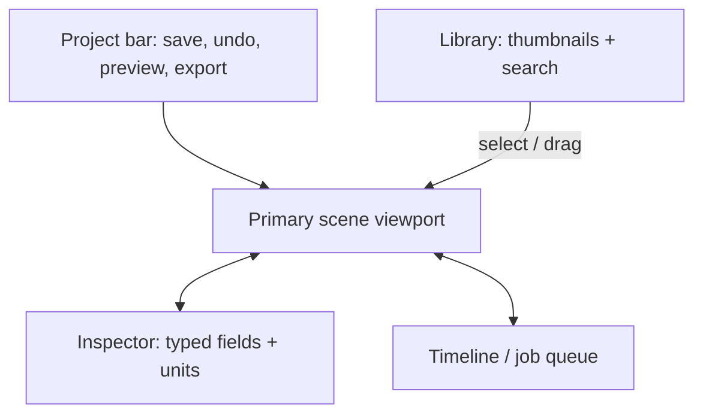
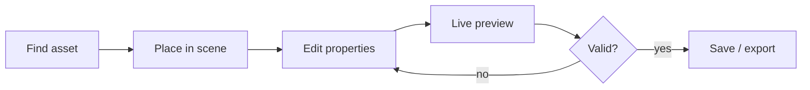

# Asset Studio — creative tool UX / UI specification

Status: **J0 approved design requirements; J2 implementation pending**.
Goal: a useful production environment for scenes, characters, furniture, props, sprites, and animation, not a metadata browser with another coat of CSS.

## Studio as a creative workspace

This diagram specifies **information relationships, not a pixel-perfect mockup**. The central canvas must dominate. Panels collapse on small screens; inspector properties use specialized, unit-aware controls. Dense raw JSON, walls of logs and flat metadata cards are reserved for developer diagnostics.

### Representative edit-to-export journey

Each arrow represents a working action to demonstrate at J2; the diagrams must eventually be accompanied by real screenshots and desktop/mobile UX checks.

## Users and essential workflows

1. **Scene authoring:** choose/create a room → choose an asset from the library → place and align with grid guides → inspect pivot/layer/collision → test trigger → preview in game → save/export.
2. **Photo or model import:** drop reference → identify rights/source → choose character/furniture/prop → inspect silhouette / directions → edit master → select pixel/palette profile → compare before/after → approve export.
3. **Animation:** pick an asset and state (\`idle\`, \`walk\`, \`talk\`, \`interact\`, \`open\`, \`active\`) → edit timeline → preview in all directions → validate pivots, frame durations and collision → save.
4. **Library management:** find by visual thumbnail, scene, type, license, status and tags → compare variants → inspect dependencies → replace safely.
5. **Portfolio QA:** switch scene in preview → simulate interaction → verify project content and click targets → run local validation → publish only after rights checks.

## Desktop workspace layout (responsive, not fixed pixels)

- Top bar: current project/scene, dirty state, undo/redo, save, preview, export and diagnostics.
- Left navigation: collapsible scene tree + search/filterable asset library with **visual thumbnails** and sensible empty states.
- Primary canvas: dominant space, pan/zoom, crisp nearest-neighbor rendering, toggles for tile/grid/origin/pivots/colliders/occlusion/actors. Avoid cramped previews.
- Right inspector: **typed** property groups, contextual labels, unit-aware inputs, validations, help-on-demand; no raw JSON dump by default.
- Bottom tray: collapsible timeline or job queue; stays out of the way of scene editing.
- Optional compare split: reference vs generated result, on-canvas overlay/diff; not a separate unreadable log page.
- Narrow screens: one primary working surface at a time with tabs/drawers; no horizontal page scroll to access Save or Preview.

## Information presentation contract

| Information | Correct UI treatment | Do not do |
| --- | --- | --- |
| Scene object hierarchy | Navigable tree with clear selection | Flat wall of scene JSON |
| Scene geometry and relationships | Actual viewport overlays, mini-map when useful | ASCII diagram or prose-only coordinates |
| Animation frames and timing | Scrubbable timeline with onion skin and frames | Huge serialized frame list |
| Provenance/rights | Compact status, source, license and expandable details | Unverified green labels or vague 'AI-generated' rights |
| Image generation results | Before/after visual comparison, zoom and diff highlight | Text description substituted for image |
| Numeric transform/collision data | Typed inputs grouped by semantic field, units shown | Huge generic key/value blocks |
| Validation and import failures | Concise issue list with asset links, severity, repair actions | Unstructured multi-page console log |
| Large asset libraries | Virtualized grid/list, facets and search, lazy thumbnail loading | Render thousands of tiles at once |
| Technical diagnostic exports | Explicitly downloadable JSON/CSV/log with schema/version | Dense logs in the everyday creative UI |

Visual hierarchy: readable contrast, clear heading levels, legible labels, consistent spacing, limited accent colors and native-feeling controls. Avoid arbitrary decorations, novelty dashboards, tiny muted text, overflowing code snippets, generic cards repeated for every property, or schemas displayed as decorative flowcharts.

## Editing behavior and safety

- Single selection has Inspector; multi-selection exposes only shared actions; selection remains stable across sort/filter.
- Undo/redo and explicit save/dirty indicator; autosave only with recovery/version history and clear controls.
- Background generation has queued/running/failed/success status and cancellation/retry; nonblocking viewport.
- Drag-and-drop validates dimensions/alpha/licensing before mutation. Never silently downscale, crop or palette-snap without displaying a comparison and an explicit acceptance step.
- Editable fields have input ranges and actual schema validation. Clarify units: px, grid cells, frames, milliseconds and FPS must not be confused.
- Keyboard navigation, focus styles, accessible labels, reduced-motion option; touch/pointer interaction tested for preview.
- Editing failures preserve user's original source and last known-good generated asset. No writes to the public hosted site.
- Use real artwork or clearly marked fixtures for UI tests; do not embed copyrighted LBA preview thumbnails into public build.

## Main design deliverables at J2

- Functional low-fidelity workflow map; at least two competing layouts reviewed against actual tasks.
- High-fidelity prototype at desktop and narrow viewport sizes; test readability with realistic long names and large scenes.
- Actual working shell (library, viewport, inspector, timeline), keyboard handling, resilient loading and error states.
- Visual comparison and at least one true end-to-end editing flow against a versioned original asset manifest.
- UX quality gate: creator can complete basic edit, preview and export without editing JSON, hunting for controls, losing content or mistaking a preview for the output file.

## Reusing the existing metadata-ui

Retain \`metadata-ui/src/AssetUploader.jsx\` as a functional reference for comparison and \`metadata-ui/vite.config.js\` as an example of a **local-only** write API. Audit its assumptions about proprietary palettes and hardcoded scene IDs before reuse. Extract reusable view logic into small typed components; do not migrate the 37 KB+ monolithic App JSX verbatim.
