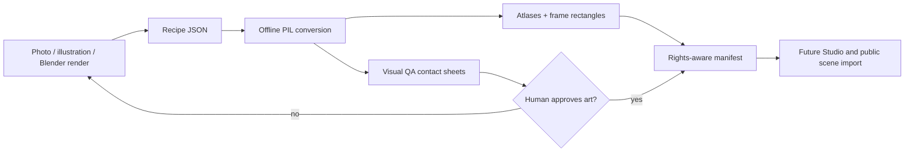

# Asset-first pipeline — production contract (J2)

The public portfolio is a **consumer** of authored graphics. The pipeline is the producer. Do not spend J2 creating a new Blender/Aseprite-style editor.



## Single-entry interface

```bash
python3 -m pip install Pillow==11.3.0
python3 pipeline/asset_batch.py path/to/recipe.json --out output/my-assets
# Open output/my-assets/index.html for *real exported* sprite contact sheets
```

Only Pillow, no servers, no account, no cloud calls. A Blender glTF/GLB source is rendered offline using [the existing Blender adapter](blender/render_iso.py) first, then its PNG views are referenced by the same JSON recipe. A photo can produce **one observed view** only; no code can reliably reconstruct hidden surfaces from it. Do not claim the tool generates a rig, character motion, or missing camera directions.

## Supported metadata

```json
{
  "schemaVersion":1,
  "project":"example-workshop",
  "style":{"width":96,"height":112,"colors":64,"padding":4},
  "assets":[{
    "id":"camera","kind":"prop",
    "source":{"origin":"original-photo","creator":"author",
      "license":"original","reviewStatus":"pending","allowedForPublicBuild":false},
    "frames":[
      {"path":"sources/camera.png","action":"idle","direction":"SE","durationMs":200}
    ]
  }]
}
```

Paths must be within the recipe folder (no traversal), images are PNG/JPEG/WebP; frames can have distinct action names/directions. The renderer uses **one scale and foot baseline for all frames of an asset**, a shared limited palette for each atlas, explicit per-frame rectangles, and source SHA-256 provenance. The generated `assets.json` remains in the **asset authoring format**, not yet the public runtime schema. J5 will require tested conversion before declaring runtime parity.

## QA, licensing and constraints

- Every asset requires a source rights record. Output is **pending review** by default; an explicit approved source is required for public use. LBA original artworks, voices, locations and ripped models are not valid public input.
- A contact sheet and static HTML review gallery are generated; review the actual PNGs at game resolution, not concept mockups.
- Alpha is preserved; source image EXIF rotation is applied; RGB images work but need a clean background or manual mask before production. A constant-color background key is optional, not semantic segmentation.
- Camera and palette consistency come from the **sources and shared style recipe**; quantization cannot repair inconsistent lighting or projection.
- Keep image and source rights separated from software code licensing; generated art does not automatically acquire commercial-use clearance.

## Existing open-source candidates: evaluated, not vendored

| Candidate | Capability | Decision |
| --- | --- | --- |
| [pseudo-pixel](https://github.com/craigrusselltiu/pseudo-pixel) | Reference image → AI-assisted 3D + rig + 8-direction Blender sprites | Optional advanced experiment. Requires Blender 5.2+, local GPU/model dependencies; too heavy for baseline |
| [BTRSpriteStudio](https://github.com/MangasMango/BTRSpriteStudio) | Multi-angle Blender sprite render, compare and batch | Useful reference; GPL code and UI not copied |
| [iso-render-pipeline](https://github.com/craigrmccown/iso-render-pipeline) | Blender orthographic sprite renderer and downsample scripts | Useful for camera/render conventions; inspect license and maintenance before integration |
| [isobake](https://github.com/HermanRas/blender_3d_to_2d_isobake) | Anchor-preserving multi-direction atlas and manifests | GPL, good technical reference; no vendored code |

No external repository has been incorporated. Future optional integrations require independent version, license, installation and sample-output verification.

## Acceptance

J2 engineering is complete when the recipe builder passes malformed-input, alpha, common-scale, metadata, orientation, and deterministic output tests. **Visual quality is a separate approval**; synthetic test art is not a substitute for a professionally styled original final asset.
